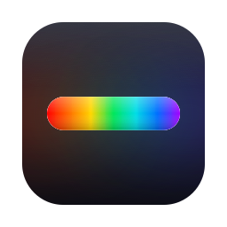
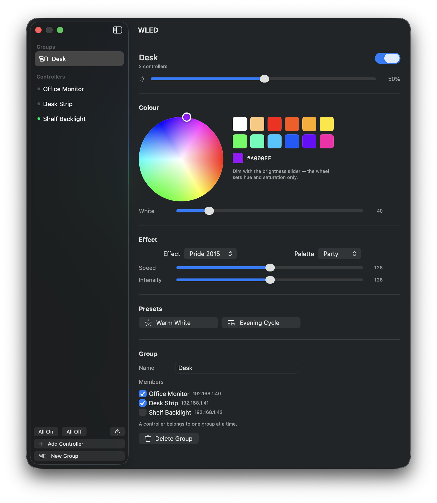
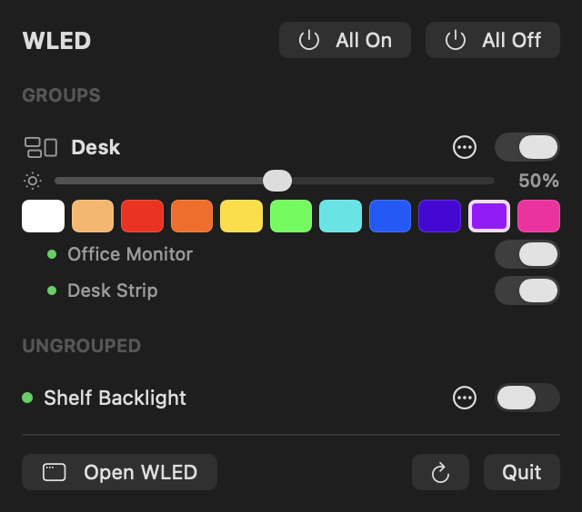

<p align="center">
  
</p>

<h1 align="center">wled-macos</h1>

<p align="center">
  A native macOS client for <a href="https://kno.wled.ge/">WLED</a>.<br>
  Menu bar for quick control, main window for everything else.
</p>

<p align="center">
  
</p>

Built with SwiftUI. No third-party dependencies, no Xcode project, and no Apple
Developer account needed.

## Two surfaces

- **Menu bar** — quick control, everything one click deep. All On / All Off,
  per-row power, brightness and an 11-colour spectrum strip. The overflow menu
  holds only what a row cannot already do: presets, open in the main window,
  open the controller's own web UI.
- **Main window** — an inline hue/saturation colour wheel, effects, palettes,
  speed and intensity, plus the white channel on RGBW strips. A sidebar of
  groups and controllers feeds one shared detail pane, and adding controllers
  and editing groups happens there too.

<p align="center">
  
</p>

## Features

- Automatic discovery over Bonjour (`_wled._tcp`) — no IP entry, no subnet sweep
- Groups with synced power, brightness, colour, effect and palette
- Live state over WebSocket, so changes made from the phone app or a physical
  button show up here without polling
- Presets, including playlists
- White-channel slider on RGBW strips, hidden on strips without one

Rows collapse to name and toggle when a light is off, and a dropped request is
retried rather than latched as an error.

## Requirements

- macOS 14 or later
- Command Line Tools (`xcode-select --install`) — **Xcode is not required**

## Build

```sh
./build.sh && open ./build/WLED.app
```

`build.sh` compiles with `swiftc`, assembles the `.app` by hand and ad-hoc signs
it. Nothing to install.

Ad-hoc signing is enough to run indefinitely on the machine that built it. It is
*not* enough to distribute: another Mac needs Developer ID signing and
notarization, or Gatekeeper blocks it.

The app launches as a menu bar accessory (`LSUIElement`), so it has no Dock icon
until a window is open.

## First run

macOS asks for **Local Network** access. Grant it — Bonjour discovery silently
returns nothing if denied, which is why the popover shows a warning rather than
an empty list. If discovery still finds nothing, open the window and add a
controller by IP; that isolates whether the problem is Bonjour or HTTP.

## How it talks to WLED

| Purpose | Call |
| --- | --- |
| Read everything | `GET /json` — state, info, effects and palettes in one request |
| Write | `POST /json/state` — `{"on":"t"}`, `{"bri":128}`, `{"fx":12}`, `{"ps":3}` |
| Presets | `GET /presets.json` |
| Live updates | `ws://<host>/ws` — state pushed on change from any source |
| Discovery | mDNS `_wled._tcp.local` |

Continuous controls are debounced per host, so dragging a slider never floods a
controller. Only the device list and group definitions are persisted; live state
is always re-read, so the UI cannot report a stale idea of what the lights are
doing.

## Regenerating the icon

`AppIcon.icns` is committed, so a normal build does not need this.

```sh
swift Tools/make-icon.swift Resources
iconutil -c icns Resources/AppIcon.iconset -o Resources/AppIcon.icns
```

## Not planned

Room mapping and visualisation, Stream Deck automation, segment editing.
